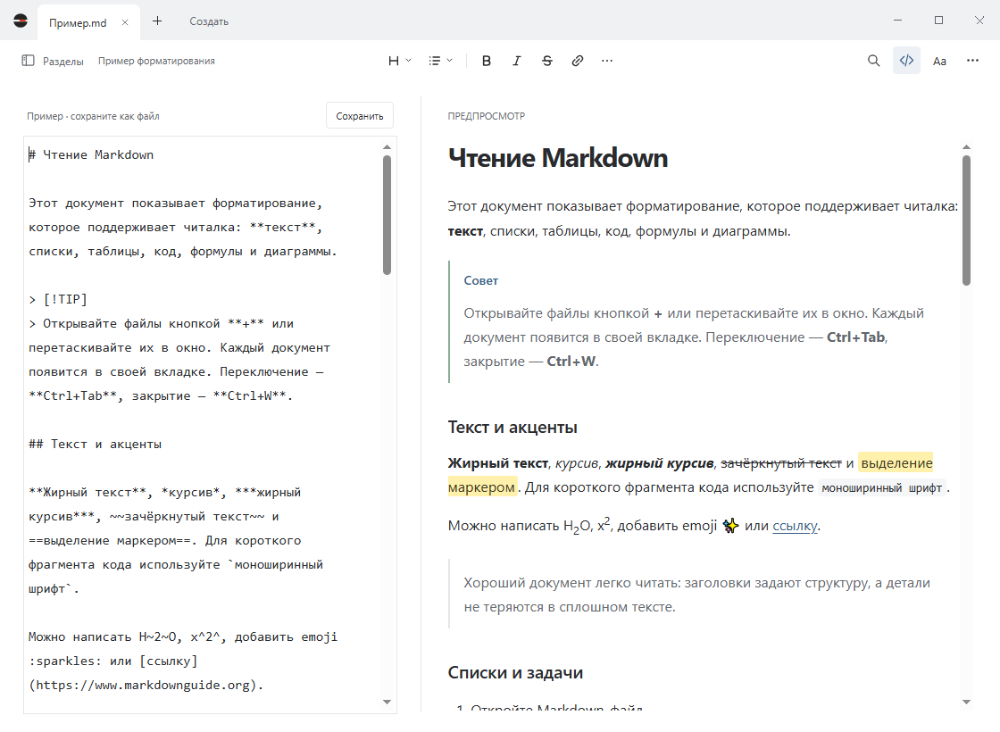

# Dokvi: Markdown reader and editor for Windows

**English** · [Русский](docs/README.ru.md)

Dokvi is a free, open-source app for reading and editing `.md` files on Windows. Open a README, notes, or documentation with formatting, then edit the Markdown source beside a live preview.

**3.0.0 · Windows x64 · English / Russian · MIT**

[Download for Windows](https://github.com/TrooSlash/Dokvi/releases) · [User guide (RU)](README.txt) · [Changelog (RU)](CHANGELOG.md) · [Report a bug](https://github.com/TrooSlash/Dokvi/issues)



Source and preview scroll together. Drag the divider to resize the panes. The screenshot shows the Russian interface; English is also available. [View reading mode](docs/images/reading.png).

## Open Markdown files on Windows

Requirements: **Windows 10 version 2004 or later / Windows 11, x64**, [.NET Framework 4.8](https://dotnet.microsoft.com/en-us/download/dotnet-framework/net48), and [Microsoft Edge WebView2 Evergreen Runtime](https://developer.microsoft.com/microsoft-edge/webview2/). The runtimes are separate from the EXE. Node.js is not needed to use Dokvi. The 3.0.0 EXE is about **3.4 MiB**, excluding these system components.

1. Download **Dokvi-3.0.0.exe** from [Releases](https://github.com/TrooSlash/Dokvi/releases). The *Source code* archives contain the project, not a ready-to-run app.
2. Keep the EXE in a permanent folder and run it. Dokvi itself does not need installation.
3. Click **+** to open files, drag them into the window, or click **New** to create a document.
4. Press **Ctrl+S** to save. For a new file, choose its name and folder.

Open the built-in example to try the supported formatting, or press **F1** for help. This release has no publisher signature or installer.

## Features

- **Reading.** Table of contents, text search, and controls for font size, reading width, and text position.
- **Editing.** Source-only or split view, formatting buttons for selected text, undo and redo, and indentation with Tab and Shift+Tab.
- **Tabs.** Multiple documents, a scrolling tab strip, and a tab list with search by name or path.
- **Markdown.** Tables, task lists, footnotes, blockquotes, syntax highlighting, LaTeX math, and Mermaid diagrams.
- **PDF export.** Export the current text, including unsaved edits. Wide tables use landscape pages; images and diagrams scale to fit. [Export guide](docs/markdown-to-pdf.md).
- **Appearance.** Light and dark themes, with English and Russian interfaces. Use the Windows language or choose one manually.
- **Recovery.** Open tabs and unsaved drafts return after a restart from local recovery copies.

Theme and language are in **⋯**; reading layout controls are in **Aa**. The empty window starts without loading WebView2. The engine loads when you open a document and is released when you close the last tab.

## Saving and recovery

A dot on a tab marks unsaved changes. Closing an edited document offers to save, discard, or cancel. A new, untouched document closes without a prompt.

Recovery copies do not overwrite your files: press **Ctrl+S** to write changes to disk. A crash can lose the latest characters that have not yet reached a recovery copy. Tabs you close and changes you explicitly discard are not restored.

Settings and recovery copies are stored in `%LOCALAPPDATA%\MD Reader Native`. Version 3.0.0 uses the same profile as 2.x. Close the previous version before replacing its EXE. See the [user guide (RU)](README.txt) for details.

## Open .md files with a double-click

Choose **⋯ → Default app…**. Dokvi registers its supported file types for the current user and opens Windows settings. Assign Dokvi to `.md` files there.

Markdown files get a separate MD document icon. The `.txt` association stays unchanged. If you move the EXE, register it again from its new folder.

## Keyboard shortcuts

| Action | Shortcut |
| --- | --- |
| New / open | Ctrl+N / Ctrl+O |
| Save / save as | Ctrl+S / Ctrl+Shift+S |
| Close tab | Ctrl+W |
| Next / previous tab | Ctrl+Tab / Ctrl+Shift+Tab |
| Switch reading / editor with preview | Ctrl+E |
| Find text / table of contents | Ctrl+F / Ctrl+B |
| Undo / redo | Ctrl+Z / Ctrl+Y |
| Save PDF | Ctrl+P |
| Help | F1 |

In the editor, **Tab** indents and **Shift+Tab** outdents. To move from the text to buttons, press **Escape**, then **Tab**. Help contains the full shortcut list.

## Formats and limits

Dokvi opens `.md`, `.markdown`, `.mdown`, `.mkd`, and `.txt` files up to **20 MB**. Supported encodings are UTF-8, UTF-16 LE/BE, and Windows-1251. If automatic detection chooses the wrong encoding, select it in **⋯**.

A single Enter appears as a line break; additional blank lines are preserved. Other Markdown apps may render these breaks differently. Obsidian and MDX extensions may remain plain text. HTML is sanitized to remove scripts, iframes, and inline styles.

Math and diagrams work offline. Remote images need an internet connection. Local images can be loaded from the document's folder and its subfolders; save a new document into the intended folder first.

Large documents need more memory and may take longer to update. Very wide diagrams and matrices shrink during PDF export; zooming may be needed to read the details.

## Build from source

Open PowerShell in the project root, next to `package.json`. You need Windows x64, Node.js with npm, and .NET Framework 4.8.

```powershell
npm ci
npm run build
```

The output is `dist/Dokvi-3.0.0.exe`. The first build downloads the WebView2 SDK from NuGet and needs internet access. `package-lock.json` pins the UI dependencies.

The host uses C# / Windows Forms. The document and editor share one WebView2 across all tabs. Dokvi does not use Electron. [Project structure and development commands (RU)](docs/development.md).

## Tests

```powershell
npm run test:unit
npm test
```

App tests use separate profiles in `dist/test-data`. Run mouse and keyboard scenarios sequentially in an unlocked Windows session. [Test suites and their limits (RU)](docs/development.md#проверки).

## Feedback

In [Issues](https://github.com/TrooSlash/Dokvi/issues), include your Dokvi and Windows versions, steps to reproduce, and the expected and actual result. For rendering bugs, attach a small Markdown example with personal information removed.

## Author and license

By [TrooSlash](https://github.com/TrooSlash). [Support the author](https://tips.tips/000491268).

Copyright (c) 2026 TrooSlash. Dokvi is released under the [MIT license](LICENSE). Third-party components retain their own licenses: [notices](ui/THIRD-PARTY-NOTICES.txt). The WebView2 SDK license is embedded in the EXE at build time.
