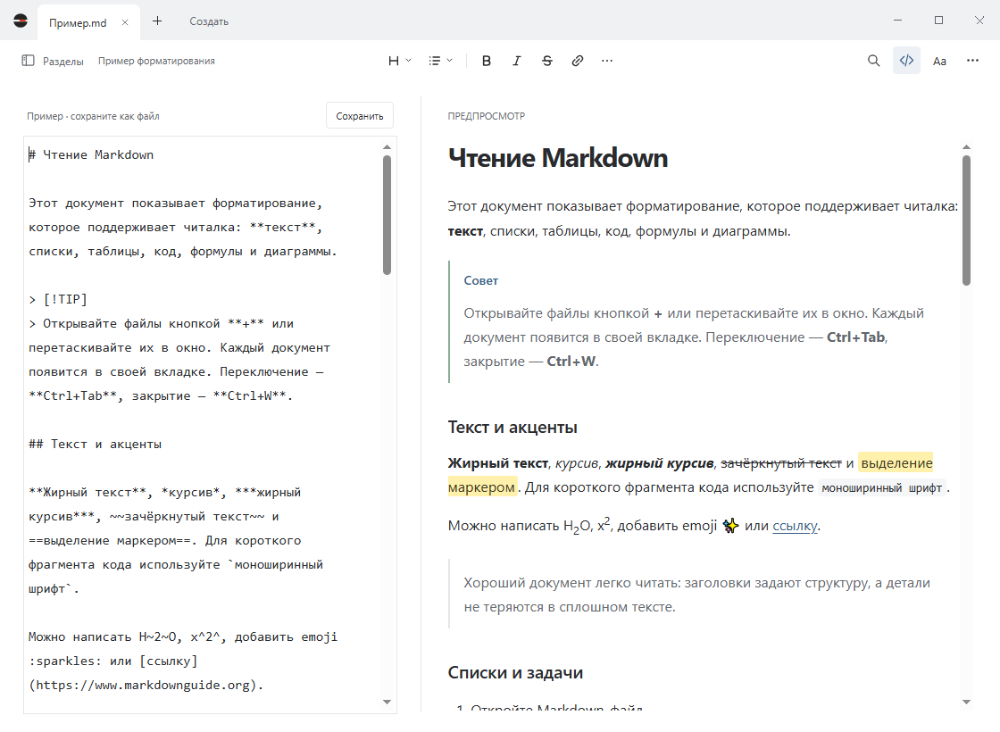

# Dokvi: читалка и редактор Markdown для Windows

[English](../README.md) · **Русский**

Dokvi — бесплатная программа с открытым исходным кодом для чтения и редактирования файлов `.md` в Windows. Откройте README, заметки или документацию с форматированием; при редактировании исходник и предпросмотр видны рядом.

**3.0.0 · Windows x64 · Русский / English · MIT**

[Скачать для Windows](https://github.com/TrooSlash/Dokvi/releases) · [Руководство](../README.txt) · [Изменения](../CHANGELOG.md) · [Сообщить об ошибке](https://github.com/TrooSlash/Dokvi/issues)



Исходник и результат прокручиваются синхронно. Границу между панелями можно перетаскивать. На снимке русский интерфейс; также доступен английский. [Посмотреть режим чтения](images/reading.png).

## Как открыть Markdown-файл в Windows

Нужны **Windows 10 версии 2004 или новее / Windows 11, x64**, [.NET Framework 4.8](https://dotnet.microsoft.com/en-us/download/dotnet-framework/net48) и [Microsoft Edge WebView2 Evergreen Runtime](https://developer.microsoft.com/microsoft-edge/webview2/). Эти компоненты не входят в EXE. Node.js для запуска не нужен. EXE версии 3.0.0 занимает около 3,4 МиБ; это размер самой программы, без системных компонентов.

1. Скачайте **Dokvi-3.0.0.exe** из раздела [Releases](https://github.com/TrooSlash/Dokvi/releases). Архив *Source code* содержит исходники, а не готовую программу.
2. Положите EXE в постоянную папку и запустите его. Устанавливать сам Dokvi не требуется.
3. Нажмите **«+»**, чтобы открыть файлы, перетащите их в окно или нажмите **«Создать»** для нового документа.
4. **Ctrl+S** сохраняет изменения. Для нового файла появится выбор имени и папки.

Для знакомства нажмите **«Посмотреть пример»**, для справки — **F1**. Выпуск пока без цифровой подписи издателя и без установщика.

## Возможности

- **Чтение.** Оглавление, поиск по тексту, настройка размера шрифта, ширины и положения области чтения.
- **Редактирование.** Исходник отдельно или рядом с предпросмотром, форматирование выделения кнопками, отмена и повтор действий, отступы через Tab и Shift+Tab.
- **Вкладки.** Несколько документов, прокрутка полосы вкладок и список с поиском по имени и пути.
- **Markdown.** Таблицы, задачи, сноски, цитаты, подсветка кода, формулы LaTeX и диаграммы Mermaid.
- **PDF.** Экспорт текущего текста, включая несохранённые правки. Широкие таблицы получают альбомную страницу, изображения и схемы подгоняются под страницу. [Инструкция экспорта](markdown-to-pdf.md#сохранить-markdown-в-pdf-на-windows).
- **Оформление.** Светлая и тёмная темы, русский и английский интерфейс. Язык определяется по Windows или выбирается вручную.
- **Восстановление.** Открытые вкладки и несохранённые черновики возвращаются после перезапуска из локальных резервных копий.

Тема и язык находятся в **«⋯»**, настройки области чтения — в **«Aa»**. Пустое окно запускается без WebView2; движок загружается при открытии документа и освобождается после закрытия последней вкладки.

## Сохранение и восстановление

Точка на вкладке означает несохранённые изменения. При закрытии изменённого документа Dokvi предлагает сохранить текст, отбросить его или отменить закрытие. Новый пустой документ закрывается без вопроса.

Резервные копии не изменяют исходные файлы: для записи в файл нужен **Ctrl+S**. После сбоя последние ещё не записанные символы могут потеряться. Вкладки, закрытые пользователем, и явно отброшенные правки не восстанавливаются.

Настройки и копии находятся в `%LOCALAPPDATA%\MD Reader Native`. Версия 3.0.0 использует тот же профиль, что и 2.x. Перед заменой EXE закройте предыдущую версию. Подробнее — в [руководстве](../README.txt).

## Открытие .md двойным щелчком

Выберите **«⋯ → Приложение по умолчанию…»**. Dokvi зарегистрирует форматы для текущего пользователя и откроет настройки Windows. Назначьте Dokvi для `.md` средствами Windows.

Для Markdown-файлов используется отдельный значок «Плашка MD». Ассоциация `.txt` не меняется. Если переместить EXE, регистрацию нужно повторить из новой папки.

## Клавиши

| Действие | Сочетание |
| --- | --- |
| Создать / открыть | Ctrl+N / Ctrl+O |
| Сохранить / сохранить как | Ctrl+S / Ctrl+Shift+S |
| Закрыть вкладку | Ctrl+W |
| Следующая / предыдущая вкладка | Ctrl+Tab / Ctrl+Shift+Tab |
| Чтение / редактор с предпросмотром | Ctrl+E |
| Найти текст / открыть оглавление | Ctrl+F / Ctrl+B |
| Отменить / повторить | Ctrl+Z / Ctrl+Y |
| Сохранить PDF | Ctrl+P |
| Справка | F1 |

В редакторе **Tab** добавляет отступ, **Shift+Tab** уменьшает его. Чтобы перейти от текста к кнопкам, нажмите **Escape**, затем **Tab**. Полный список сочетаний есть в справке.

## Форматы и ограничения

Открываются `.md`, `.markdown`, `.mdown`, `.mkd` и `.txt` размером до **20 МБ**. Поддерживаются UTF-8, UTF-16 LE/BE и Windows-1251. Если кодировка определилась неверно, выберите её в меню «⋯».

Обычный Enter отображается как новая строка; дополнительные пустые строки сохраняются. Другие Markdown-программы могут отображать такие переносы иначе. Расширения Obsidian и MDX могут оставаться обычным текстом. HTML очищается от скриптов, iframe и встроенных стилей.

Формулы и диаграммы работают без интернета. Удалённым изображениям нужно подключение. Локальные картинки доступны из папки документа и её подпапок; новый документ сначала сохраните в нужную папку.

Большие документы требуют больше памяти и могут обновляться с задержкой. Очень широкие схемы и матрицы уменьшаются при экспорте в PDF; для деталей может понадобиться увеличение страницы.

## Сборка

Откройте PowerShell в корне исходников, рядом с `package.json`. Нужны Windows x64, Node.js с npm и .NET Framework 4.8.

```powershell
npm ci
npm run build
```

Результат — `dist/Dokvi-3.0.0.exe`. При первой сборке загружается WebView2 SDK с NuGet; нужен интернет. Зависимости интерфейса фиксирует `package-lock.json`.

Оболочка написана на C# / Windows Forms, документ и редактор работают в одном WebView2 для всех вкладок. Electron не используется. [Устройство проекта и команды разработки](development.md).

## Проверки

```powershell
npm run test:unit
npm test
```

Тесты приложения используют отдельные профили в `dist/test-data`. Сценарии с мышью и клавиатурой запускайте последовательно в разблокированном сеансе Windows. [Наборы проверок и их ограничения](development.md#проверки).

## Обратная связь

В [Issues](https://github.com/TrooSlash/Dokvi/issues) укажите версию Dokvi и Windows, шаги воспроизведения, ожидаемый и фактический результат. Для ошибки отображения приложите небольшой Markdown-пример без личных данных.

## Автор и лицензия

Автор — [TrooSlash](https://github.com/TrooSlash). [Поддержать автора](https://tips.tips/000491268).

Copyright (c) 2026 TrooSlash. Dokvi распространяется по [лицензии MIT](../LICENSE). Сторонние компоненты сохраняют свои лицензии: [уведомления](../ui/THIRD-PARTY-NOTICES.txt). Лицензия WebView2 SDK включается в ресурсы EXE при сборке.
