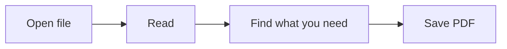

# Reading Markdown

This document shows the formatting supported by Dokvi: **text**, lists, tables, code, formulas and diagrams.

> [!TIP]
> Open files with **+** or drag them into the window. Each document opens in its own tab. Switch tabs with **Ctrl+Tab** and close them with **Ctrl+W**.

## Text and emphasis

**Bold text**, *italic*, ***bold italic***, ~~strikethrough~~ and ==highlight==. Use `monospace text` for a short piece of code.

Write H~2~O or x^2^, add an emoji :sparkles: or a [link](https://www.markdownguide.org).

> Headings make a document easier to navigate and help readers find the details they need.

## Lists and tasks

1. Open a Markdown file.
2. Choose a comfortable text size.
3. Read, search and navigate with the outline.
   - Nested lists work too.
   - The file changes only when you save it.

- [x] Basic formatting
- [x] Tables and syntax highlighting
- [ ] Your next document

## Tables

| Feature | How to use it |
| :--- | :--- |
| Open | Button, drag and drop, or `Ctrl+O` |
| Search | `Ctrl+F`, then `Enter` |
| Outline | “Outline” button or `Ctrl+B` |
| Edit | `</>` button or `Ctrl+E` |
| Source and preview | `Ctrl+Shift+E` |
| Export | “…” menu → “Save PDF” |

## Highlighted code

Put the language name after three backticks. The button in the corner copies the entire block.

```python
from pathlib import Path

def read_markdown(filename):
    """Read text using UTF-8 encoding."""
    return Path(filename).read_text(encoding="utf-8")

print(read_markdown("notes.md"))
```

## Formulas

An inline formula: $E = mc^2$. A separate block for a longer expression:

$$
\int_0^1 x^2\,dx = \frac{1}{3}
$$

## Diagrams

Fenced `mermaid` blocks become diagrams in the document.



## Footnotes and details

Move additional explanations into a footnote.[^note]

Markdown
: A way to format plain text.

<details>
<summary>Click to show details</summary>

Text, tables, formulas and diagrams work **offline**. Online images and links need an internet connection.

</details>

> [!NOTE]
> No single Markdown standard covers every extension. Dokvi supports Markdown and common additions; features specific to other editors may appear as plain text.

[^note]: Footnotes appear at the bottom of the document. The arrow returns to the reference.
