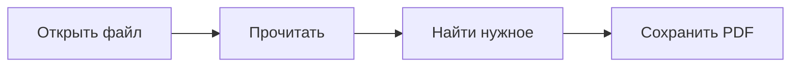

# Чтение Markdown

Этот документ показывает форматирование, которое поддерживает читалка: **текст**, списки, таблицы, код, формулы и диаграммы.

> [!TIP]
> Открывайте файлы кнопкой **+** или перетаскивайте их в окно. Каждый документ появится в своей вкладке. Переключение — **Ctrl+Tab**, закрытие — **Ctrl+W**.

## Текст и акценты

**Жирный текст**, *курсив*, ***жирный курсив***, ~~зачёркнутый текст~~ и ==выделение маркером==. Для короткого фрагмента кода используйте `моноширинный шрифт`.

Можно написать H~2~O, x^2^, добавить emoji :sparkles: или [ссылку](https://www.markdownguide.org).

> Хороший документ легко читать: заголовки задают структуру, а детали не теряются в сплошном тексте.

## Списки и задачи

1. Откройте Markdown-файл.
2. Выберите удобный размер текста.
3. Читайте, ищите и переходите по оглавлению.
   - Вложенные списки тоже поддерживаются.
   - Файл меняется только после команды «Сохранить».

- [x] Обычное форматирование
- [x] Таблицы и подсветка кода
- [ ] Ваш следующий документ

## Таблицы

| Возможность | Как пользоваться |
| :--- | :--- |
| Открытие | Кнопка, перетаскивание или `Ctrl+O` |
| Поиск | `Ctrl+F`, затем `Enter` |
| Оглавление | Кнопка «Разделы» или `Ctrl+B` |
| Редактирование | Кнопка `</>` или `Ctrl+E` |
| Текст и результат рядом | `Ctrl+Shift+E` |
| Экспорт | Меню «…» → «Сохранить PDF» |

## Код с подсветкой

Язык указывается после трёх обратных кавычек. Кнопка в углу копирует весь блок.

```python
from pathlib import Path

def read_markdown(filename):
    """Открываем текст в кодировке UTF-8."""
    return Path(filename).read_text(encoding="utf-8")

print(read_markdown("заметки.md"))
```

## Формулы

Формула внутри строки: $E = mc^2$. Отдельный блок для более подробной записи:

$$
\int_0^1 x^2\,dx = \frac{1}{3}
$$

## Диаграммы

Блоки `mermaid` превращаются в схемы прямо в документе.



## Сноски и детали

Дополнительные пояснения можно вынести в сноску.[^note]

Markdown
: Простой способ форматировать обычный текст.

<details>
<summary>Нажмите, чтобы раскрыть подробности</summary>

Текст, таблицы, формулы и диаграммы работают **без интернета**. Подключение понадобится только для изображений и ссылок из сети.

</details>

> [!NOTE]
> Не существует одного стандарта со всеми расширениями Markdown. Читалка поддерживает обычный Markdown и популярные дополнения; специальные конструкции отдельных редакторов могут отображаться как текст.

[^note]: Сноски собираются внизу документа. Стрелка возвращает к месту упоминания.
